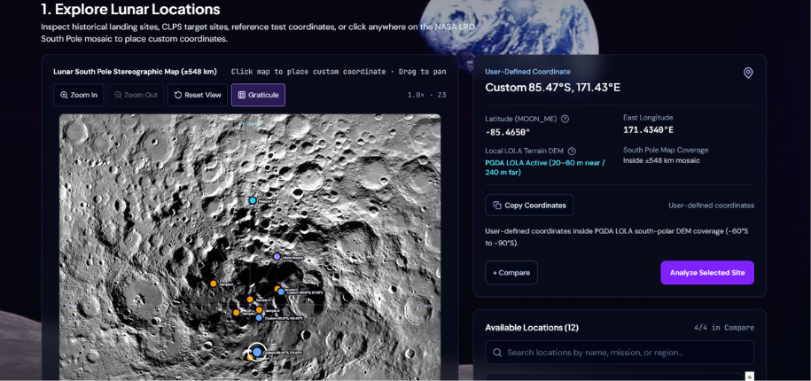
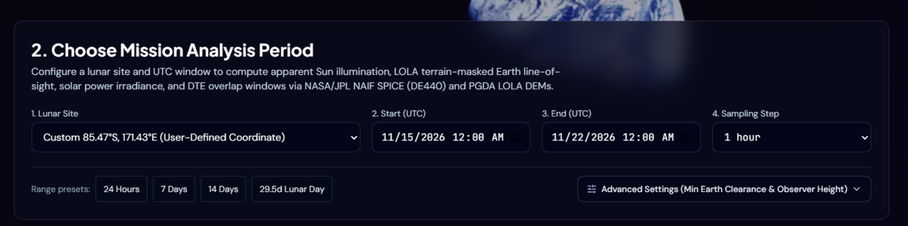
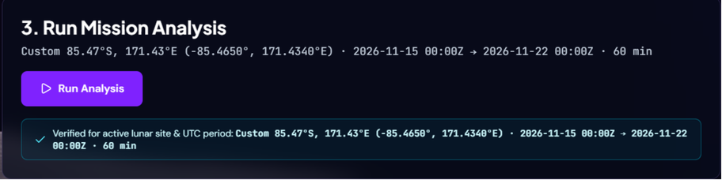
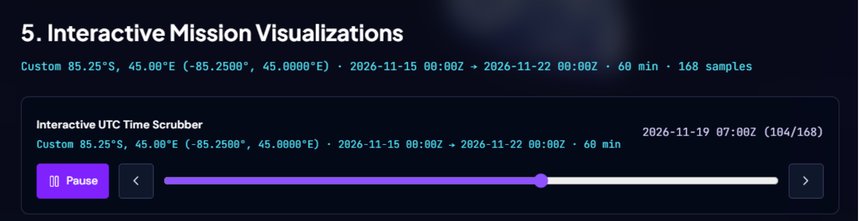
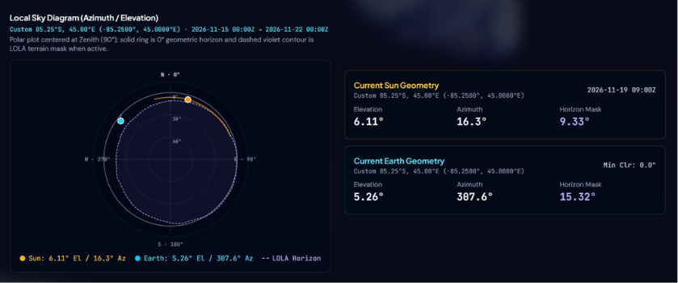
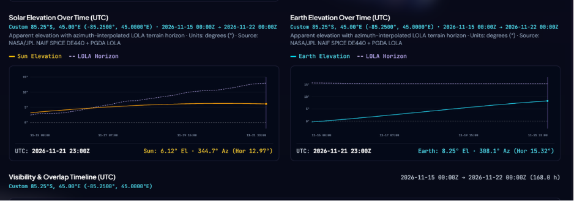
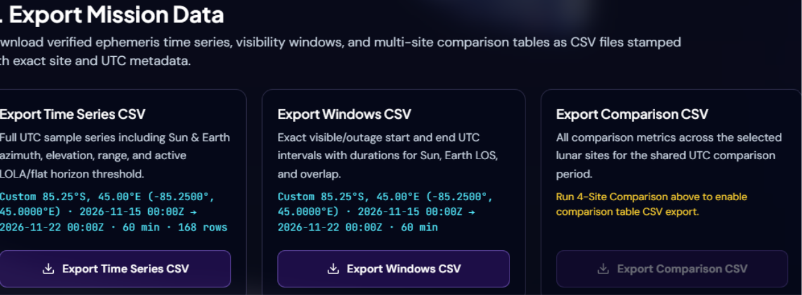

# 🌕 CLPS Lunar Landing Site Navigator

### Beyond the Horizon. Toward the Moon.

An interactive lunar mission-planning platform that uses NASA/JPL data and scientific calculations to explore and compare potential lunar landing sites, particularly near the Moon's South Pole.

---

## 🚀 Project Overview

Selecting a suitable lunar landing site requires understanding sunlight availability, Earth visibility, terrain obstructions, and potential communication opportunities.

CLPS Lunar Landing Site Navigator brings these factors together in an interactive platform to support lunar mission analysis and site comparison.

## ✨ Key Features

- **Lunar Location Exploration:** Explore potential lunar landing sites.
- **Mission Analysis:** Select locations and analysis periods.
- **Sunlight Analysis:** Calculate solar elevation, azimuth, and visibility windows.
- **Earth Visibility:** Analyze Earth's elevation, azimuth, and geometric visibility.
- **Terrain Horizon Assessment:** Evaluate terrain obstructions where elevation data is available.
- **Solar Power Assessment:** Examine solar illumination conditions.
- **DTE Communication:** Identify potential Direct-to-Earth visibility windows.
- **Interactive Visualizations:** Explore charts, sky diagrams, and mission timelines.
- **Multi-Site Comparison:** Compare up to four lunar landing sites.
- **CSV Export:** Download scientific mission analysis data.

---

## 🖥️ Application Screenshots

### 1. Explore Lunar Locations



### 2. Choose Mission Analysis Period



### 3. Run Mission Analysis



### 4. Interactive Time Scrubber



### 5. Local Sky Diagram



### 6. Solar & Earth Elevation Charts



### 7. Direct-to-Earth (DTE) Communication

.png)

### 8. Scientific Data Export

Export mission analysis results and comparison datasets as CSV files for further scientific analysis and reuse.


---

## 🛰️ Scientific Data & Technologies

| Source / Technology | Purpose |
|---|---|
| NASA/JPL SPICE | Planetary and lunar geometry calculations |
| JPL DE440 | Planetary and lunar ephemeris data |
| NASA LOLA DEM | Lunar elevation and terrain horizon analysis |
| NASA LRO WAC | Lunar surface imagery |
| JPL Horizons | Ephemeris validation and fallback calculations |
| SpiceyPy | Python interface for SPICE |
| NumPy | Scientific numerical computing |

## 🛠️ Technology Stack

- React
- TypeScript
- Vite
- Node.js
- Python
- SpiceyPy
- NumPy
- Docker

## 📂 Project Structure

```text
CLPS-Lunar-Landing-Site-Navigator/
├── kernels/
├── public/
├── screenshots/
│   ├── Explore_Lunar_Locations.jpg
│   ├── Choose_Mission_Analysis_Period.png
│   ├── Run_Mission_Analysis.png
│   ├── Interactive_Time_Scrubber.png
│   ├── Solar_Earth_Elevation_Charts.png
│   ├── Local_Sky_Diagram.png
│   ├── Direct-to-Earth (DTE).png
│   └── csv-export_2.png
├── scripts/
├── src/
├── tests/
├── Dockerfile
├── package.json
├── requirements.txt
├── server.ts
└── README.md
```

## ⚙️ Getting Started

### Prerequisites

- Node.js
- Python
- Git

### 1. Clone the repository

```bash
git clone https://github.com/Mohamedn7n/CLPS-Lunar-Landing-Site-Navigator.git
cd CLPS-Lunar-Landing-Site-Navigator
```

### 2. Install dependencies

```bash
npm install
pip install -r requirements.txt
```

### 3. Run the application

```bash
npm run dev
```

Open the local address displayed in your terminal.

## 🧪 Testing

Run the automated tests:

```bash
npm test
```

Run TypeScript checks:

```bash
npm run lint
```

Build the application:

```bash
npm run build
```

## 📊 Scientific Methodology

The platform analyzes the geometric relationship between the Sun, Earth, and selected lunar surface locations over a specified mission period.

It evaluates:

- Solar elevation and azimuth.
- Earth elevation and azimuth.
- Sunlight and Earth visibility intervals.
- Terrain horizon obstruction where terrain data is available.
- Overlapping visibility opportunities.
- Comparative mission conditions across candidate sites.

## ⚠️ Scientific Assumptions & Limitations

- Geometric sunlight visibility does not guarantee sufficient electrical power.
- Geometric Earth visibility does not guarantee a successful communication link.
- Actual communication performance depends on additional mission and system constraints.
- Terrain obstruction analysis depends on available elevation data and coverage.
- This application is a mission-planning support tool, not a complete spacecraft trajectory simulator.

## 📥 Scientific Data Export

Users can export mission analysis results and comparison datasets in CSV format for further investigation and external processing.

## 🏆 Competition

Developed for the **NASA Space Apps Challenge 2026**.

## 👨‍💻 Developer

**Mohamed Osama**

---

<p align="center">
  <b>CLPS Lunar Landing Site Navigator</b><br>
  <i>Beyond the Horizon. Toward the Moon.</i>
</p>
